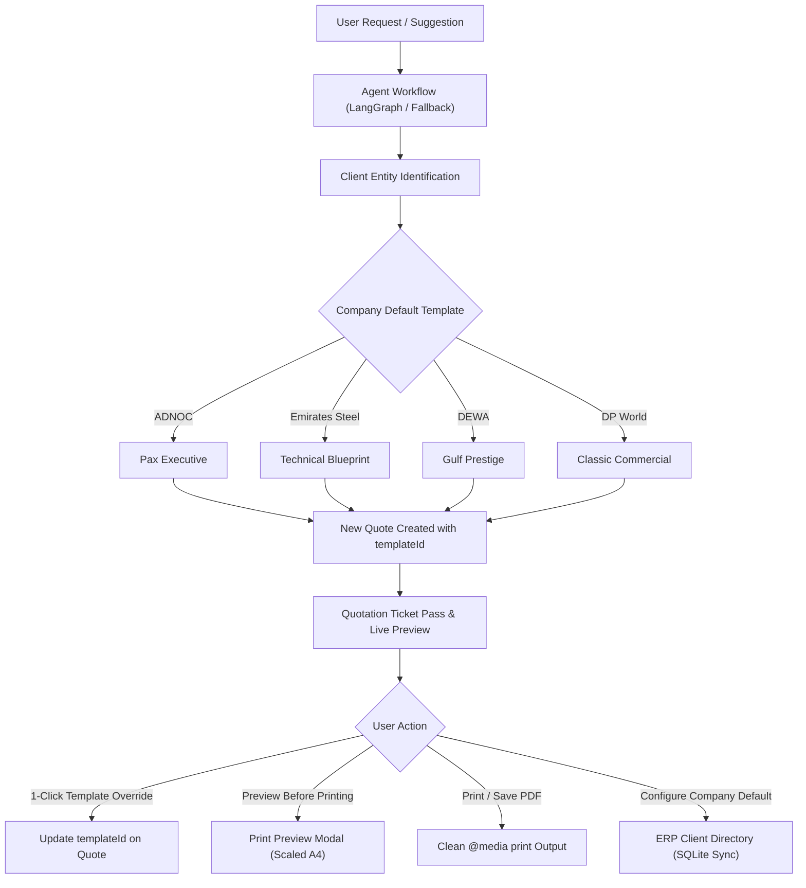

# Pax ERP Quotation Templates & Print Engine Guide

This document describes the multi-template quotation architecture, company default mappings, per-quote template overrides, and print engine implemented in the **Pax ERP AI Quotation Suite**.

---

## 1. Architecture Overview

The quotation template engine allows commercial quotes to be displayed and printed in multiple executive designs while maintaining consistency with company defaults and preserving historical quote styling.



---

## 2. Available Quotation Templates

The suite includes 4 distinct commercial templates designed for enterprise, sovereign, and industrial procurements:

### A. Pax Executive (`executive`)
* **File:** `frontend/src/templates/ExecutiveTemplate.jsx`
* **Theme & Accent:** Modern minimalist corporate slate (`#9db5a3` / `#1e293b`).
* **Target Audience:** Multinational corporate accounts, board-level approvals, and executive procurements.
* **Key Visual Features:**
  - Executive summary header with issuance date, guaranteed validity pill, and document reference.
  - Dual-column Client vs. Pax Issuing Entity metadata grid.
  - Clean tabular line items with standard list price, tier discount deduction, and net payable.
  - Financial investment summary callout (Annual Software + One-time Implementation).
  - Commercial terms & guarantees (Net 30 electronic, 24/7 dedicated SLA, UAE sovereign hosting).
  - Level-3 security authorization stamp with Jordan Davis's signature line.

### B. Gulf Prestige (`prestige`)
* **File:** `frontend/src/templates/GulfPrestigeTemplate.jsx`
* **Theme & Accent:** Sovereign UAE enterprise luxury emerald (`#064e3b` / `#059669`) and warm gold (`#b45309` / `#d97706`).
* **Target Audience:** UAE government entities, sovereign wealth funds (ADIA, Mubadala), and regional holdings.
* **Key Visual Features:**
  - Bilingual header (`عـرض أسـعـار تـجـاري معتمد | Official Commercial Quotation`).
  - Pax Enterprise Systems branding with Arabic calligraphy styling (`باكس لأنظمة المؤسسات`).
  - Official UAE Federal Tax Registration Number (TRN: `100482910000003`) and Commercial License tag (`CN-1092837`).
  - Enterprise Client Protocol card with tenant location and preferential pricing agreement tier.
  - Emerald table header with gold border highlights and bilingual column descriptions.
  - MoHRE / WPS compliance certifications and TDRA sovereign cloud data residency.
  - Official circular emerald & gold verification seal with Arabic/English lettering, plus bilateral client acceptance and PO sign-off box.

### C. Technical Blueprint (`technical`)
* **File:** `frontend/src/templates/TechnicalBlueprintTemplate.jsx`
* **Theme & Accent:** High-density engineering specification with monospace typography (`#0f172a` / `#0284c7` / `#38bdf8`).
* **Target Audience:** Heavy industrial manufacturing, telecommunications, and engineering procurements.
* **Key Visual Features:**
  - Engineering specification header with tenant pod ID (`AZ-UAE-NORTH-01`) and compute specs (K8s isolated namespace, AES-256 GCM encryption).
  - SHA256 checksum verification tag (`SHA256:7B94-E481-99C1`).
  - Technical Bill of Materials (BOM) with technical SKU codes (`ERP-CORE`, `MOD-HR`, `MOD-SCM`, `SVC-IMPL`).
  - Infrastructure SLA & recovery metrics matrix (99.95% uptime, RTO < 15m, RPO < 5m, automated hourly snapshots, WPS 2.0 SIF format).
  - DevOps & Lead Solutions Architect verification box with GPG key ID and commit verification checksum (`commit: 8a4f91b`).

### D. Classic Commercial (`classic`)
* **File:** `frontend/src/templates/ClassicCommercialTemplate.jsx`
* **Theme & Accent:** Traditional corporate tender stationery on formal ADGM letterhead (`#475569` / `#1e293b`).
* **Target Audience:** Banking and financial institutions, legal entities, and formal government tenders.
* **Key Visual Features:**
  - Pax Enterprise Systems Ltd. registered letterhead header (Level 14, Al Sila Tower, Abu Dhabi Global Market Square, Al Maryah Island, Abu Dhabi).
  - Formal recipient correspondence address and tenderer block with salutation.
  - Official subject statement and formal scope narrative.
  - Schedule A commercial scope and fee breakdown.
  - Milestone payment schedule (Milestone 1: 50% upon PO & provisioning; Milestone 2: 50% upon UAT sign-off).
  - Legal warranty clauses, ADGM governing law specification, and embossed Pax corporate seal.

---

## 3. Company Default Templates

Each enterprise company in the system has a pre-assigned default template:

| Company | Default Template | Primary Sector | Discount Tier |
|:---|:---|:---|:---|
| **ADNOC Group** | `Pax Executive` | Oil & Gas | Gold - 20% Discount |
| **Emirates Steel** | `Technical Blueprint` | Heavy Industry | Silver - 10% Discount |
| **DEWA (Dubai Electricity & Water)** | `Gulf Prestige` | Government Utility | Platinum - 25% Discount |
| **DP World** | `Classic Commercial` | Global Logistics | Platinum - 25% Discount |
| **Emirates Airlines** | `Pax Executive` | Aviation | Gold - 20% Discount |
| **Mubadala Investment Company** | `Gulf Prestige` | Sovereign Wealth | Platinum - 25% Discount |
| **Dubai Holding** | `Pax Executive` | Conglomerate | Gold - 20% Discount |
| **ADNOC Offshore** | `Technical Blueprint` | Energy Operations | Gold - 20% Discount |
| **Aldar Properties** | `Classic Commercial` | Real Estate | Silver - 10% Discount |
| **Etisalat e&** | `Technical Blueprint` | Telecommunications | Gold - 20% Discount |
| **First Abu Dhabi Bank (FAB)** | `Gulf Prestige` | Banking & Finance | Gold - 20% Discount |
| **Dubai Airports** | `Pax Executive` | Aviation Infrastructure | Gold - 20% Discount |

### Modifying Company Defaults
1. Open the **ERP Client Directory & Defaults** tab in the top navigation.
2. Under the client card, locate the **Default Template** selector dropdown.
3. Select any template (Executive, Prestige, Technical, or Classic).
4. The client's default template is updated in memory and synchronized with the SQLite database via `PATCH /clients/{id}`.
5. All future quotations drafted for this company will automatically select the newly chosen template.

---

## 4. Per-Quote Template Override & Persistence

* **Per-Quote Override Bar:** When viewing any quotation, the **Quotation Template Override** section provides 4 interactive cards. Clicking any card immediately switches the active quote's template.
* **Persistence Guarantee:** The chosen template is saved directly on the quote object (`quote.templateId`). Switching between quotes (via previous/next arrows `←` / `→`, the quick switcher list, or the search filter) preserves each quote's assigned template so that historical quotes keep their original look.
* **Override Indicator:** The UI clearly marks quotes that are `[Using Company Default]` vs. those with a `[Per-Quote Override Active]`. A **"Revert to Company Default"** button is available to return to the company's designated template at any time.

---

## 5. Print Preview & Print Engine

### Print Preview Modal
* Located in `frontend/src/templates/PrintPreviewModal.jsx`.
* Triggered by clicking **"Preview Before Printing"** from either the ticket pass or the proposal header.
* Features:
  - Renders an authentic scaled A4 sheet (`max-w-[840px]`) with document shadow and margins.
  - Includes an in-modal template switcher so users can test designs directly in print view.
  - Dedicated **"Print Document"** action button.
  - Keyboard accessible (close with `Escape`).

### Print Styling (`@media print`)
* Located in `frontend/src/index.css`.
* When `window.print()` is called:
  - All application chrome (`header`, `footer`, `nav`, search bar, onboarding tour, stats grid, agent execution trace, ticket controls, sidebar buttons) is hidden via `display: none !important;`.
  - The quotation document occupies 100% page width on crisp white paper with dark text.
  - Preserves borders, vector seals, background badges, and table alternating rows using `-webkit-print-color-adjust: exact; print-color-adjust: exact;`.
  - Enforces `page-break-inside: avoid;` to prevent awkward table breaks across pages.

---

## 6. Backend Integration & Database Schema

### Database (`pax_erp.db`)
The `clients` table in SQLite stores the default template for each client:

```sql
CREATE TABLE IF NOT EXISTS clients (
    id INTEGER PRIMARY KEY,
    name TEXT,
    discount_tier TEXT,
    contact TEXT,
    tenant_info TEXT,
    default_template TEXT DEFAULT 'executive'
);
```

### API Endpoints
* **`GET /clients`**: Returns list of all ERP clients including `default_template`.
* **`PATCH /clients/{client_id}`**: Updates a company's default template in SQLite:
  ```json
  { "default_template": "prestige" }
  ```
* **`POST /generate`**: Accepts user natural language request, executes LangGraph workflow, queries SQLite, and returns:
  ```json
  {
    "quotation": "# Commercial Quotation...",
    "logs": ["🧭 Classifier Node: ...", "💾 SQL Tool: ..."],
    "client_name": "ADNOC Group",
    "default_template": "executive"
  }
  ```

---

## 7. Step-by-Step User Workflow

1. **Select an Existing Quote**:
   - Use the navigation arrows `←` / `→` or the quick switcher to inspect preloaded quotes.
   - Observe how `QUO-2026-2048` displays in **Pax Executive**, `QUO-2026-2051` in **Technical Blueprint**, and `QUO-2026-2057` in **Gulf Prestige**.
2. **Override a Template on an Existing Quote**:
   - Click **Gulf Prestige** on Quote `QUO-2026-2048`. The quote changes to the emerald/gold design and saves this setting.
   - Switch to another quote and switch back; `QUO-2026-2048` remains in the overridden template.
3. **Draft a New Quote**:
   - In the prompt input, enter:
     `Generate a quote for DEWA for Enterprise ERP License and HR Module`
   - Click **Generate Quote**.
   - Notice the trace log: `🎨 Template Engine: Auto-selected company default template [GULF PRESTIGE]`.
   - The newly generated quotation displays in DEWA's default Gulf Prestige template automatically.
4. **Change a Company's Default Template**:
   - Click the **ERP Client Directory & Defaults** tab.
   - Change DEWA's default template to **Technical Blueprint**.
   - Click **Draft Quote →** on DEWA. The prompt is populated and the next quote generated for DEWA will use Technical Blueprint.
5. **Preview and Print**:
   - Click **Preview Before Printing** to inspect the A4 paper layout.
   - Click **Print Document** (or press `Ctrl+P`) to print to paper or save as a PDF.
